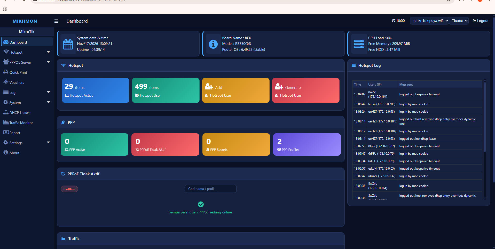
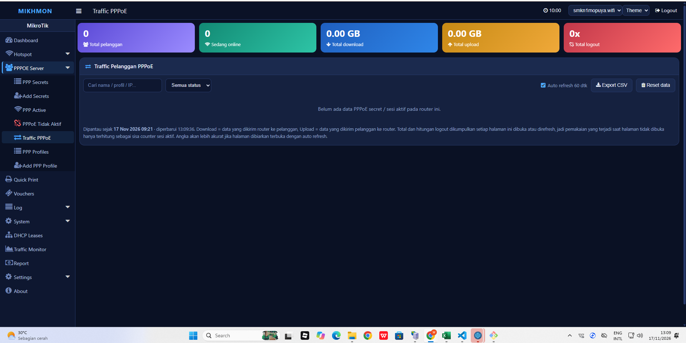

---

Mikhmon-PPPoE-Ros.7
📌 Deskripsi

**Mikhmon-PPPoE-Ros.7** adalah aplikasi berbasis web yang dikembangkan untuk memudahkan manajemen user PPPoE pada Mikrotik RouterOS versi 7.x. Dengan antarmuka sederhana dan fitur yang lengkap, aplikasi ini membantu admin jaringan dalam mengelola, monitoring, dan mengotomatisasi tugas-tugas terkait PPPoE user secara efisien.

---

✨ Fitur Utama

- **Manajemen User PPPoE**  
  Tambah, edit, hapus, dan monitoring user PPPoE dengan mudah.

- **Dashboard Interaktif**  
  Menampilkan data statistik user aktif, penggunaan bandwidth, dan performa router.

- **Otomatisasi Voucher**  
  Generate dan cetak voucher internet dengan cepat.

- **Backup & Restore**  
  Fitur backup/restore konfigurasi user PPPoE.

- **Keamanan**  
  Akses login untuk admin, serta log aktivitas.

---

 Screenshot

> 

---

Lisensi

Perangkat lunak ini hanya diperbolehkan untuk penggunaan pribadi.  
**Dilarang keras** menggandakan, mendistribusikan, memodifikasi, atau menggunakan untuk tujuan komersial tanpa izin tertulis dari pemilik.

Copyright © 2025 Dwinet

---

Kontribusi

Kontribusi sangat terbatas karena lisensi penggunaan pribadi. Untuk pertanyaan, silakan hubungi saya melalui:

- [GitHub Issues]([https://github.com/heruhendri/Mikhmon-PPPoE-Ros.7/issues](https://github.com/wayan1998/MIKHMON-MOD-PPPOE-FULLFITUR-Ros7/issues))
- Email:developerwayan@gmail.com

---

Catatan

- Pastikan RouterOS sudah update ke versi 7.x.
- Selalu backup data sebelum melakukan perubahan besar.

---

Terima kasih telah menggunakan **Mikhmon-PPPoE-Ros.7**!  
Dukung terus pengembangan tools open-source dengan tetap menghormati lisensi penggunaan.

---

